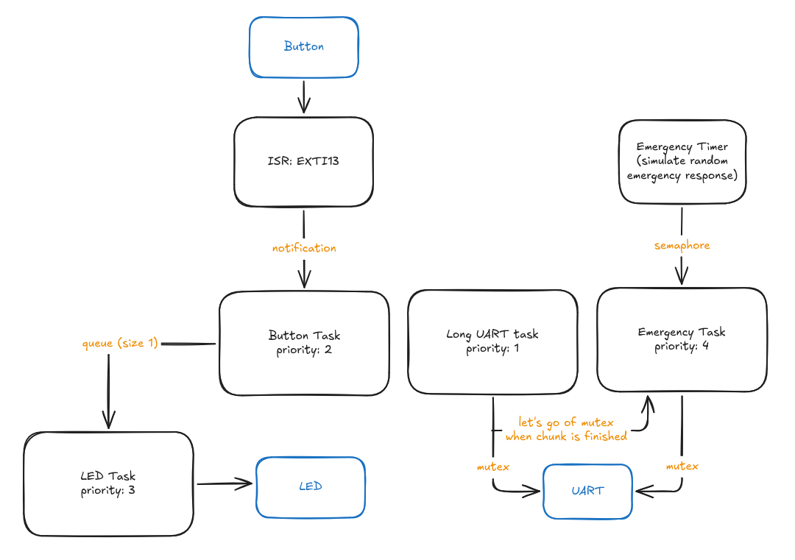

# MP3: learning to use FreeRTOS

**Embedded Software (FA26): Mini Project 3**

## Overview

This project refactors MP1 into a preemptive FreeRTOS application. MP1 configured the GPIO, timer, and used an EXTI interrupt for the mode button and a periodic timer interrupt for the blink pattern. A button press changes the output pattern of the LED. The refactor keeps the same board, button, and LED, but also adds a USART2 data stream that was not part of the original project.

The UART was added to create a scenario that would need RTOS to coordinate: blinking that happens either at 1, 2, and 4hz, a UART transmission that takes up to 2 seconds, and an emergency UART signal that happens every 7 seconds. The core behavior is the same: a button-cycled light that keeps running without blocking the CPU. And with RTOS, we can make this happen even when there is a long-standing task that takes up to 2 seconds.

## 1. Project choice

MP1 is the starting point for this project. It already has an interrupt-driven system with a physical input and a time-based output, which maps directly into two different tasks: a button task and a periodic LED task. But MP1 is a weak case for an RTOS as a superloop with two interrupts already satisfies its timing needs. There is no shared peripheral, no blocking operation, and no inter-task data flow.

Hence, I decided to add a twist to the project with a UART data stream that did not exist in MP1.

1. **It creates a slow shared resource.** A 23 KB burst at 115200 baud takes about 2 s. In a bare-metal superloop, that transmission would monopolize the CPU and stall the safety light. With an RTOS, the burst belongs to a low-priority task that is preempted by the LED and button tasks, so the light keeps blinking and the button stays responsive.
2. **It creates a real shared-resource problem.** If two tasks now write to the same UART, there must be a mutex to protect the resource from multiple tasks hijacking the UART stream.
3. **It needs priority assignment.** The LED has a 125 ms deadline, the button needs to feel responsive just enough for the user experience, and the UART has a 5 s budget. These are different urgencies competing for one CPU, which is precisely the situation that needs an RTOS.

The addition is also similar to MP1's design constraint that the CPU must remain free to process other events. MP1 prohibited software delay loops for that reason, and the RTOS version enforces the same property even while a slow transfer is running.

## 2. System Behavior

- The light has three button-selected modes. MP1's modes were off, solid, and 4 Hz blink. This refactor has the same number of modes but uses 1 / 2 / 4 Hz frequnecies instead.
- Each press of the button advances the mode and therefore the blink rate.
- Every 5 s, the added telemetry task prints 230 lines of 100 characters (23,000 bytes, about 2.0 s at 115200 baud).
- Every 7 s, an emergency banner is printed, regardless of what else is running.

## 3. Architecture

## 4. Tasks and scheduling

All tasks are created in `AppRtosInit()` (`Core/Src/freertos.c:78`) before `osKernelStart()`.

| Task | Priority | Trigger | Stack | Responsibility |
|---|---|---|---|---|
| `EmergencyTask` | 4 (highest) | Binary semaphore, every 7 s | 256 words (1 KB) | Print `!!! EMERGENCY !!!` under the UART mutex |
| `LedTask` | 3 | Periodic, `vTaskDelayUntil` | 256 words | Toggle the LED at the rate selected by the mode queue |
| `ButtonTask` | 2 | Task notification from EXTI | 256 words | Debounce 50 ms, cycle the mode 0→1→2 |
| `LongUartTask` | 1 (lowest) | Periodic, every 5 s | 256 words | Send 230 × 100 B with the mutex taken per chunk |

**Priority rationale.** Priorities follow urgency and frequency:

- `EmergencyTask` is highest because its output is the most time-sensitive and it must preempt a background transfer.
- `LedTask` needs a stable 125 ms worst case half-period, so it sits above the button and UART.
- `ButtonTask` is event-driven and tolerant of a few milliseconds, but still needs to beat the UART task.
- `LongUartTask` is throughput-oriented and has a 5 s budget, so it is lowest.

**Timing budget.** At 115200 8N1, the link carries 11,520 B/s. A 100 byte chunk takes the UART about 8.7 ms, so the full 23,000 byte message is about 2.0 s.

## 5. Design decisions

### Task decomposition

There is one task per triggered (notifications and semaphores) and periodic event rather than one task per peripheral. `LedTask` handles all blinking, `LongUartTask` handles all bulk output, `ButtonTask` handles all button presses. This keeps each task's state local and makes blocking behavior explicit. The UART is shared by two tasks, which is exactly why it needs a mutex rather than being folded into one task.

### Deferred interrupt processing

The EXTI callback does only two things: it checks the pin and calls `vTaskNotifyGiveFromISR`. It then yields if a higher-priority task was woken. Debouncing, mode updates, and queue writes happen in `ButtonTask`. Keeping the ISR short limits latency and keeps all blocking work out of interrupt context.

### Notification versus semaphore for the button

A direct notification is used for the ISR-to-button path because there is exactly one consumer and no data needs to accompany the event. It avoids allocating a semaphore which takes up heap data and is the cheapest ISR-safe signal. A notification is also used to drain bounce events with a zero timeout after the debounce delay. Whereas semaphores can only count up to a certain amount depending on how we set it up.

### Latest value queue for the blink mode

`modeQueue` is a one-element queue of type `uint8_t`. It acts as a place to store variables that can be accessed via different tasks but is protected for thread-safe applications. `ButtonTask` publishes with `xQueueOverwrite`, and `LedTask` reads with `xQueuePeek`. The queue stores the latest value: if the user presses the button faster than the LED updates, old modes are replaced rather than queued. `xQueuePeek` is used so the LED does not consume the value that the button published.

### Mutex for the UART

`uartMutex` is created as a mutex because the UART needs ownership, not just signaling. Mutexes in FreeRTOS implement priority inheritance. Which means if the emergency task is needed, it will also raise the priority of the long UART task until it finishes sending its current chunk. The lock is also taken per chunk rather than for the whole 23 KB transmission, so the emergency doesn't have to wait the full 2s to acquire the lock. The cost is 230 lock/unlock pairs per burst, which is negligible compared with the transmission time.

### Software timer for the emergency event

An auto-reload software timer generates the emergency event every 7s by giving a binary semaphore. This keeps the periodic trigger independent of any task's delay loop and demonstrates the timer service task. `EmergencyTask` blocks on the semaphore, so it consumes no CPU between events.

## 6. Consequences of the RTOS

### Improved responsiveness during a long transfer

The clearest change is what happens during the 2 s UART burst. In a bare-metal superloop, a blocking transmit would freeze button sampling and LED updates for the duration of the burst. Here, `LongUartTask` is priority 1, so `LedTask` (3) and `ButtonTask` (2) preempt it between chunks. A button press during the burst still changes the blink rate, and the LED keeps its cadence. This is the main reason the project benefits from an RTOS, and it is the same property MP1 demanded when it banned software delay loops.

### Timing accuracy

`vTaskDelayUntil` schedules against an absolute tick, so the LED period does not get affected by the delays of a different task. The bare-metal equivalent, `HAL_Delay`, would drift by however long each loop iteration took. The trade-off is that periodic behavior now depends on the tick rate and on higher-priority work. So if a priority work is occupying the CPU, there could still be a slight drift.

### Changed output framing

The 23,000 byte transmission is no longer guaranteed to be continuous. When the emergency timer fires, the message is inserted between the 23,000 byte transmission. So, a consumer that treats the transmission as a single framed packet will see it split, and I'm not sure whether this is a big deal. This is a real behavioral change caused by the RTOS and by the deliberate choice of per-chunk locking. Making the transmission atomic would require holding the mutex for the whole 2 s, which would delay the emergency message by up to 2 s and defeat the point of the high-priority task.

### Priority inversion and its bound

In the following scenario, `LongUartTask` holding `uartMutex`, `LedTask` (3) becoming ready, and `EmergencyTask` (4) blocking on the same mutex. Without priority inheritance, `LedTask` could start in between of `LongUartTask` and delay the releasing of the mutex to allow emergency output to run. FreeRTOS mutexes implement priority inheritance, so `LongUartTask` is temporarily moved to priority 4 and releases the mutex within one chunk, about 9 ms.

## 7. Demo and source

- **Video:** https://youtube.com/shorts/dIQrUVAj6zA

## AI Usage Disclosure

I used AI to write read_uart.py in order to test the UART functionality.